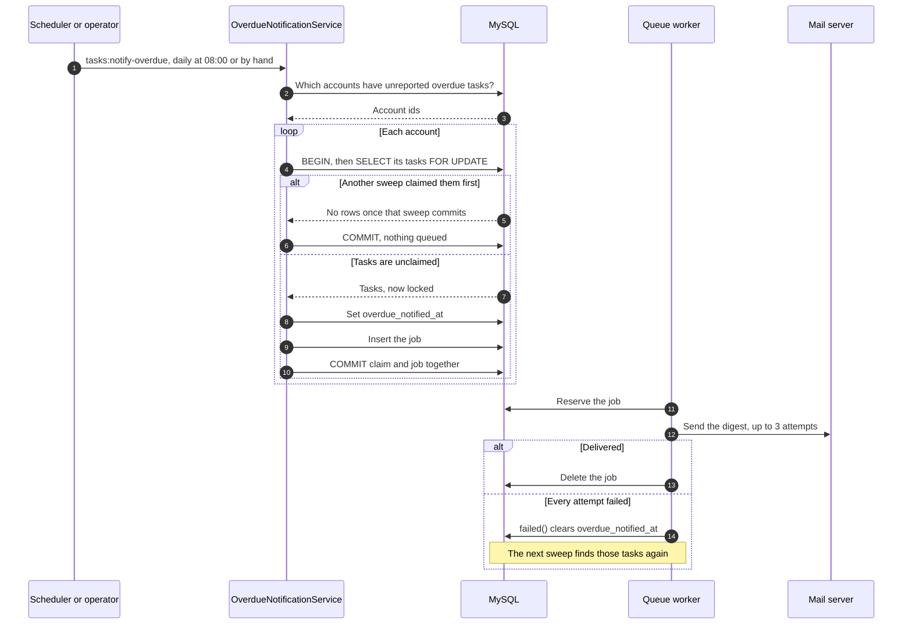

# Task Management System API

A REST API for managing projects and their tasks. Each account holder sees only their
own data, gets a dashboard that counts it, and receives a daily email naming anything
that has gone overdue. Everything is JSON. There is no user interface.

- Register, log in and log out with Laravel Sanctum tokens.
- Full CRUD on projects and on tasks, with filtering and title search on tasks.
- A dashboard endpoint returning six counts in one read.
- A queued daily digest that names each overdue task exactly once.

The endpoints are documented in the [API reference](docs/api.md).

## How it is put together

- Controllers take the request, hand it to a service and return a resource.
- Business rules live in services under `app/Services`.
- Services reach the database through repositories: an interface in
  `app/Contracts/Repositories` bound to an implementation in `app/Repositories`.
- Form requests hold validation, including their `exists` and `unique` checks.
- `App\Http\Support\ApiResponse` builds every API response body, and the exception
  handler in `bootstrap/app.php` puts failures in the same envelope.

## How the overdue email works

A task is named in one email, ever. A sweep claims a task by setting
`overdue_notified_at`, in the same transaction that queues the email.



**Why the job is queued inside the transaction.** Pushed after the commit, a queue
failure would leave tasks claimed with no email coming, and no later sweep would find
them. Pushed before it, the failure rolls the claim back and the next sweep retries.

**Why the tasks are read under a lock.** `withoutOverlapping` only keeps scheduled runs
apart, so it does not cover a sweep started by hand. The row lock does: a second sweep
waits, then finds the tasks already reported. If two sweeps deadlock, the database
abandons one and that account's claim runs again, up to 3 times.

**What this guarantees depends on the queue driver:**

| `QUEUE_CONNECTION` | The push fails | The commit fails after the push |
|---|---|---|
| `database`, on the default connection | Claim rolled back | Job rolled back with the claim |
| `redis`, `sqs`, `beanstalkd` | Claim rolled back | The job survives, so the next sweep sends a duplicate |
| `sync` | Sends inline, inside the transaction. A failed send rolls the claim back and stops the sweep | The email has gone, so the next sweep sends a duplicate |

The tests force a failed push on `database` and a failed send on `sync`. The rest of
the table follows from the same code path and is not tested here. Setting
`DB_QUEUE_CONNECTION` to a separate connection puts the `database` driver in the `redis`
row.

**What it does not guarantee.** Delivery is at least once: a worker that dies after the
mail server accepts a message, but before the job is removed, sends it again on retry.
Retrying a failed job with `queue:retry` can also repeat a digest, because `failed()`
has already released its tasks for the next sweep.

## Getting started

Needs PHP 8.4 with `pdo_mysql`, `pdo_sqlite`, `mbstring` and `openssl`, plus Composer
and MySQL. The locked dependencies do not install on PHP 8.3. CI runs PHP 8.4 and
MySQL 8.4.

```bash
composer install
```

```bash
cp .env.example .env
```

```bash
php artisan key:generate
```

```bash
mysql -u root -p -e "CREATE DATABASE task_management_sys CHARACTER SET utf8mb4 COLLATE utf8mb4_unicode_ci;"
```

Set `DB_DATABASE`, `DB_USERNAME` and `DB_PASSWORD` in `.env` to match, then:

```bash
php artisan migrate --seed
```

```bash
php artisan serve
```

The API is at `http://localhost:8000/api/v1`. To send the overdue email, run a worker
and start a sweep. With `MAIL_MAILER=log`, the email lands in `storage/logs/laravel.log`.

```bash
php artisan queue:work
```

```bash
php artisan tasks:notify-overdue
```

Scheduled sweeps also need `php artisan schedule:work`, or `schedule:run` from cron.

## Demo data

`php artisan migrate --seed` creates an account to log in with. Seeding again rebuilds
this data rather than duplicating it.

```
email:    demo@example.com
password: password123
```

It holds 4 projects and 25 tasks, 5 of them overdue, so the dashboard returns real
numbers on the first call. A second account, `other@example.com` with the same
password, owns separate data: ask for one of its projects as the demo account and you
get a `404`, the same answer as a project that never existed.

`database/dump/task_management_sys.sql` holds the same schema and data for loading
directly, with due dates fixed at the day it was exported.

## Running the tests

The main suite runs on in-memory SQLite and needs no setup.

```bash
php artisan test --compact
```

SQLite has no row locks, so the race between sweeps runs apart from it, on MySQL. It
starts the real command in separate processes and holds them at the row locks until
all of them are waiting. Create the database once:

```bash
mysql -u root -p -e "CREATE DATABASE task_management_test CHARACTER SET utf8mb4 COLLATE utf8mb4_unicode_ci;"
```

```bash
vendor/bin/pest --configuration=phpunit.concurrency.xml
```

It uses the host and credentials in `.env`, and the account must be able to read
`performance_schema`. Every run wipes `task_management_test`, and the suite refuses to
run on a database whose name does not end in `_test`. Do not start it through
`php artisan test`, which adds its own `--configuration` and makes the run exit
non-zero.

## Postman

Import `postman/task-management-system.postman_collection.json` and set its `base_url`
variable. Run **Authentication → Log in** first: the demo credentials are filled in,
and the returned token is stored for every other request.

## Project layout

```
app/Console/Commands/   The overdue sweep's entry point
app/Http/               Controllers, form requests, resources and ApiResponse
app/Jobs/, app/Mail/    The queued digest and its email
app/Repositories/       Database access, behind app/Contracts/Repositories
app/Services/           The business rules
database/               Migrations, factories, seeders and the SQL dump
docs/api.md             The API reference
postman/                The Postman collection
tests/Feature/          The main suite
tests/Concurrency/      The race between sweeps, on MySQL
```
